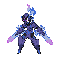
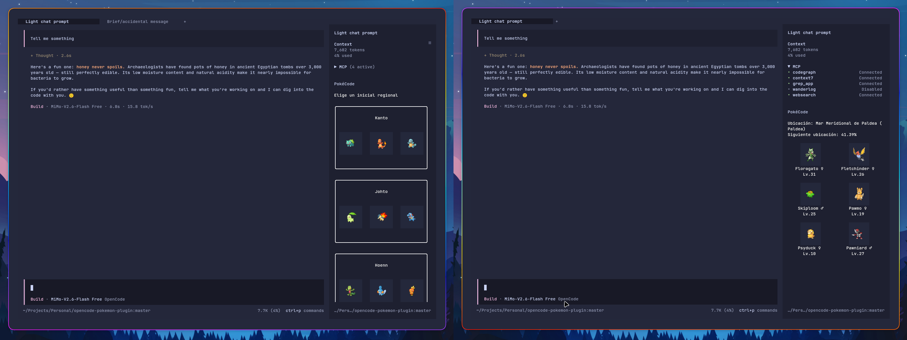

<div align="center">
  
  <h1>pokecode</h1>
  <p>
   A Pokémon adventure for OpenCode that progresses with your AI usage.
  </p>
  <p>
    <a href="#about">About</a> | 
    <a href="#progression">Progression</a> | 
    <a href="#evolution-changes">Evolution changes</a> | 
    <a href="#exploration">Exploration</a> | 
    <a href="#quick-start">Quick start</a> | 
    <a href="#commands">Commands</a> | 
    <a href="#settings">Settings</a> | 
    <a href="#storage">Storage</a> | 
    <a href="#license">License</a> | 
    <a href="#attributions">Attributions</a>

  </p>
</div>

---

## About

<div align="center">
  
</div>

`@sbugallo/pokecode` is an OpenCode V2 plugin that brings a Pokémon adventure to your TUI sidebar. 
Choose a regional starter, build a team, and discover wild Pokémon while you work. Your team gains 
experience, learns moves, and evolves as you use OpenCode.

The bundled catalog includes **1,025 base species and 41 regional forms** across nine regions: 
Kanto, Johto, Hoenn, Sinnoh, Unova, Kalos, Alola, Galar, and Paldea. Browse your discoveries in the 
National Dex, manage your collection in the PC, and export your active team in Pokémon Showdown 
format.

Progress is shared across all OpenCode sessions on the same machine, so completed work in each 
session contributes to the same adventure.

## Progression

Your active team gains experience from the tokens reported for completed assistant messages. This 
includes input, output, reasoning, and cache read/write tokens. Usage is deduplicated across 
sessions and restarts so the same message is never counted twice.

**Every 1,000 counted tokens grants 1 XP to each active Pokémon**. Fractional XP carries 
forward. Your team can hold up to six Pokémon, and only active team members earn new XP; Pokémon in 
the PC remain idle. The level cap is 100.

### Moves and evolution

Pokémon learn level-up moves automatically while they know fewer than four. Once all four slots are 
occupied, the sidebar asks you to replace a known move or decline the new one.

Single-path evolutions happen automatically at their level milestone. Branching evolutions let you 
choose the next form. Item, friendship, trade, and other special requirements are represented by 
curated level milestones rather than simulating those mechanics. Some evolution outcomes also depend
on your current region.

### Pending decisions

By default, **any pending decision pauses gameplay progression**: XP, encounters, and
location-unlock progress all wait until your choices are resolved. Tokens reported during that pause
are deduplicated and discarded, not saved for later.

Set `pauseOnPendingChoice` to `false` to keep progressing during unattended sessions. Decisions and 
encounters queue persistently, including across restarts. The sidebar shows one actionable card and
queue counts.

In this continuous mode, a Pokémon waiting for a branching evolution keeps earning XP but stops 
advancing levels at that branch. Choosing its evolution immediately processes the saved XP. Other 
team members continue normally, and move choices do not stop leveling.

## Evolution changes

To keep evolutions achievable without battles, trading, or an item inventory, **all supported**
**evolutions use level milestones**. You do not need evolution stones, held items, friendship, a 
particular time of day, weather, a known move, walking steps, battle achievements, or another
player. Stat comparisons and special party requirements are not checked either. Gender restrictions
are preserved.

The milestone policy uses these defaults when no species-specific override or existing level
threshold applies:

| Original requirement | Replacement |
| --- | --- |
| High friendship / happiness | Level 30. |
| Evolution stone or an item classified as a stone evolution | Level 36. |
| Trading, including held-item trades | Level 40. |
| Other special conditions without a retained level | Level 40. |
| Level plus an additional condition | A level milestone, retaining gender restrictions only. |

**Species-specific rules take precedence over these defaults.** Some milestones and ordinary level
evolutions are adjusted, so levels do not always match the mainline games. Examples of adapted 
evolutions:

| Evolution | Plugin level | Requirement no longer needed |
| --- | --- | --- |
| Pikachu → Raichu | 36 | Thunder Stone. |
| Golbat → Crobat | 30 | High friendship. |
| Budew → Roselia | 20 | High friendship during the day. |
| Mime Jr. → Mr. Mime | 20 | Knowing Mimic. |
| Happiny → Chansey | 25 | Holding an Oval Stone during the day. |
| Kadabra → Alakazam, Machoke → Machamp, Graveler → Golem, Haunter → Gengar | 45 | Trading. |
| Onix → Steelix | 42 | Trading while holding a Metal Coat. |
| Porygon → Porygon2 → Porygon-Z | 30 → 50 | Trading with an Upgrade, then a Dubious Disc. |
| Spritzee → Aromatisse, Swirlix → Slurpuff | 27 | Held-item trades. |
| Feebas → Milotic | 37 | Beauty or a Prism Scale trade. |
| Primeape → Annihilape | 44 | Repeated uses of Rage Fist. |
| Bisharp → Kingambit | 42 | Leader's Crest and specific battle victories. |
| Pawmo → Pawmot | 40 | Walking steps in Let's Go mode. |
| Bramblin → Brambleghast, Rellor → Rabsca | 30 | Walking steps in Let's Go mode. |
| Gimmighoul → Gholdengo | 50 | Collecting 999 Gimmighoul Coins. |
| Meltan → Melmetal | 50 | Pokémon GO's Candy-based evolution. |

### Branching evolutions

Where a Pokémon has several evolution paths, you choose the result instead of satisfying the
original branch conditions. The following branches share a milestone so an earlier automatic
evolution cannot make another option unreachable:

| Pokémon | Available choices | Level |
| --- | --- | --- |
| Eevee | Vaporeon, Jolteon, Flareon, Espeon, Umbreon, Leafeon, Glaceon, Sylveon | 25 |
| Applin | Flapple, Appletun, Dipplin | 28 |
| Kirlia | Gardevoir, Gallade | 30 |
| Nincada | Ninjask, Shedinja | 20 |
| Poliwhirl | Poliwrath, Politoed | 36 |
| Scyther | Scizor, Kleavor | 45 |
| Slowpoke | Slowbro, Slowking | 37 |
| Snorunt | Glalie, Froslass | 42 |
| Sneasel | Weavile, Sneasler | 38 |

Nincada gives you **one chosen evolution**, not both Ninjask and Shedinja. Only gender-eligible
branches are offered.

### Regional forms and availability shortcuts

Your current region changes a few evolution results: in Alola, Pikachu, Cubone, and Exeggcute evolve
into their Alolan forms; in Galar, Koffing evolves into Galarian Weezing and Mime Jr. into Galarian
Mr. Mime. The source Pokémon's milestone is unchanged by these substitutions.

Other regional evolutions still require their prerequisite form. For example, Galarian Meowth
evolves into Perrserker, Galarian Yamask into Runerigus, and Galarian Mr. Mime into Mr. Rime; their
ordinary forms do not gain those paths.

Three shortcuts remain because their prerequisite forms are not represented in the current catalog:
ordinary Sneasel can become Sneasler at 38, Qwilfish can become Overqwil at 40, and Basculin can
become Basculegion at 40.

Milestones remain valid **at or above** their level. A Pokémon caught above its evolution level can
evolve during the next applied usage event; it does not have to hit the exact level again.

## Exploration

Start in any of the nine regions and choose one of its three native starters.

Each location has its own unlock cost, charged for eligible tokens spent at your newest unlocked
location. Costs follow a power curve over the location's position in its region's story, normalized
by region length and calibrated against main-series gym-leader and champion ace levels, so your
party keeps pace with the narrative. After a region's champion, further locations cost no more than
the final approach. Use `/pokecode-locations` to travel there before working toward the following
location. Returning to an older location preserves your unlock progress, but usage there does not
advance the next unlock.

A single usage event can unlock at most one location; excess unlock progress is discarded. Travel is
always manual, even in continuous mode.

After completing a region, choose an unvisited region to unlock its first location and receive a new
level-5 regional starter. Each region grants one starter; revisiting does not grant another. A 
starter joins an empty team slot or goes to the PC if your team is full.

You can revisit unlocked locations across all visited regions. After completing all nine regions,
you can keep training, catching Pokémon, and traveling.

### Encounters and catches

An encounter opportunity occurs after a random interval of **200,000–400,000 eligible tokens** by
default. Encounters depend on your location, with curated special encounters that may be
location-specific or roam throughout a region. Locations without ordinary encounters still support
XP and exploration progress, and may have eligible special encounters.

When a wild Pokémon appears, choose **Catch** or **Run** in the sidebar. Catching always succeeds.
New catches fill the first empty team slot; if your team is full, they go to the PC. Wild Pokémon
can also be shiny.

Location previews show ordinary encounters and location-fixed specials. Seen/caught markers in 
location previews and encounter cards track the exact form.

In pause mode, one encounter waits for your response before progress resumes. In continuous mode, 
encounter overflow is preserved, so one large usage event can generate several queued encounters.

---

## Quick start

Requirements:

- OpenCode **V2**.
- Node.js **`>=20`** to run `npx`.
- Bun **`>=1.4.0`** only for local development.

1. Install the server and TUI plugin entrypoints:

   ```sh
   npx @sbugallo/pokecode init
   ```

   The installer delegates to `opencode plugin add <package>@<version>` using
   the exact package version run by `npx`.

2. Restart OpenCode.
3. Choose a region and starter from the sidebar.

After that, use OpenCode as usual. Your team, pending choices, and exploration
progress appear in the sidebar.

## Commands

| Command | Description |
| --- | --- |
| `/pokecode-locations` | Browse unlocked locations by region, preview encounters, and travel. |
| `/pokecode-dex` | Open the National Dex to browse seen and caught species. |
| `/pokecode-pc` | Browse your collection, inspect Pokémon, choose your active team, rename Pokémon, or free them. |
| `/pokecode-export` | Copy the active team in Pokémon Showdown format to the clipboard. |

In the PC, select between one and six Pokémon and confirm to replace your active team in one
operation. Press **R** to rename the inspected Pokémon (1–30 characters) or **F** to free it.
Confirm either action with **Enter**, or press **Esc** to go back without applying it. Renaming and
freeing are saved immediately, separately from team selection. Freeing is permanent, keeps your
Pokédex history, and cannot remove the last Pokémon in your saved active team.

Team exports target **Gen 9 National Dex** paste format, using your Pokémon's moves, ability, 
nature, and IVs, with zero EVs and no held items. Exporting does not validate competitive legality.
Clipboard copying depends on the available terminal/system clipboard support; the plugin reports the
result.

## Settings

Settings use OpenCode's plugin `options`; there is no separate companion settings file. Add them to
the plugin entry in your global `~/.config/opencode/opencode.jsonc` (or under 
`$XDG_CONFIG_HOME/opencode/` when set), or use a project `opencode.jsonc` for project-specific
options.

The following example uses the package name without a version for readability and shows every
default:

```jsonc
{
  "$schema": "https://opencode.ai/config.json",
  "plugins": [
    {
      "package": "@sbugallo/pokecode",
      "options": {
        "language": "en",
        "pauseOnPendingChoice": true,
        "encounterMinimumTokens": 200000,
        "encounterMaximumTokens": 400000,
        "locationUnlockBaseTokens": 4214000,
        "locationUnlockExponent": 2.64,
        "locationUnlockRegionExponent": -1.72
      }
    }
  ]
}
```

| Setting | Description |
| --- | --- |
| `language` | `en` for English or `es` for Spanish. Localizes Pokémon, locations, regions, moves, abilities, and interface text. Missing translations fall back to English. |
| `pauseOnPendingChoice` | Pauses XP, encounters, and exploration while decisions are pending. Set to `false` for continuous progression and persistent queues. |
| `encounterMinimumTokens` | Minimum eligible-token interval between encounter opportunities. |
| `encounterMaximumTokens` | Maximum eligible-token interval between encounter opportunities. |
| `locationUnlockBaseTokens` | Scale of the location-unlock cost curve. |
| `locationUnlockExponent` | How quickly unlock costs grow along a region's story. |
| `locationUnlockRegionExponent` | Normalization applied by region length so short and long regions pace alike. Typically negative. |

Token thresholds must be positive integers; the exponents are plain numbers. Reload or restart
OpenCode after changing options. Because the save is shared, use consistent gameplay settings
across concurrently running instances.

## Storage

Your trainer, team, collection, discoveries, pending choices, encounters, and usage receipts are
stored in a user-global SQLite database:

- With `XDG_DATA_HOME` set: `$XDG_DATA_HOME/pokecode/game.sqlite`.
- Otherwise: `~/.local/share/pokecode/game.sqlite`.

The save is shared across projects and concurrent OpenCode sessions on the same machine, not stored
in your repository. These paths are resolved by the OpenCode server process.

Sprites are downloaded on demand and cached separately:

- With `XDG_CACHE_HOME` set: `$XDG_CACHE_HOME/pokecode/sprites/`.
- Otherwise: `~/.cache/pokecode/sprites/`.

Cached art remains available offline. If no suitable image is available, the UI uses a placeholder.
Sprites use static Black/White-style pixel art, with shiny and female variants where available.

Before backing up or moving a save, stop all OpenCode instances using it and keep `game.sqlite`
together with any `game.sqlite-wal` and `game.sqlite-shm` files.

---

## License

This project's code is licensed under the Apache License 2.0. See [LICENSE](LICENSE)
for details. Pokémon names, characters, and artwork are not covered by this
project's code license.

## Attributions

- Inspired by [OpenCode VPet](https://github.com/sbugallo/opencode-vpet).
- Pokémon data and sprite sources come from [PokéAPI](https://pokeapi.co/),
  [PokéAPI API data](https://github.com/PokeAPI/api-data), and the
  [PokéAPI sprites repository](https://github.com/PokeAPI/sprites).
- Team exports use the
  [Pokémon Showdown team format](https://github.com/smogon/pokemon-showdown/blob/master/sim/TEAMS.md).

Pokémon is owned by Nintendo, Game Freak, and The Pokémon Company. This is an
unofficial fan project and is not affiliated with or endorsed by them.
Attribution does not grant permission to use third-party artwork; see the
[sprite license notice](https://github.com/PokeAPI/sprites/blob/master/LICENCE.txt)
for the upstream notice. Repository license labels do not establish permission
to use the underlying Pokémon artwork, including community-contributed fan
sprites. Third-party asset rights have not been cleared by this project.
